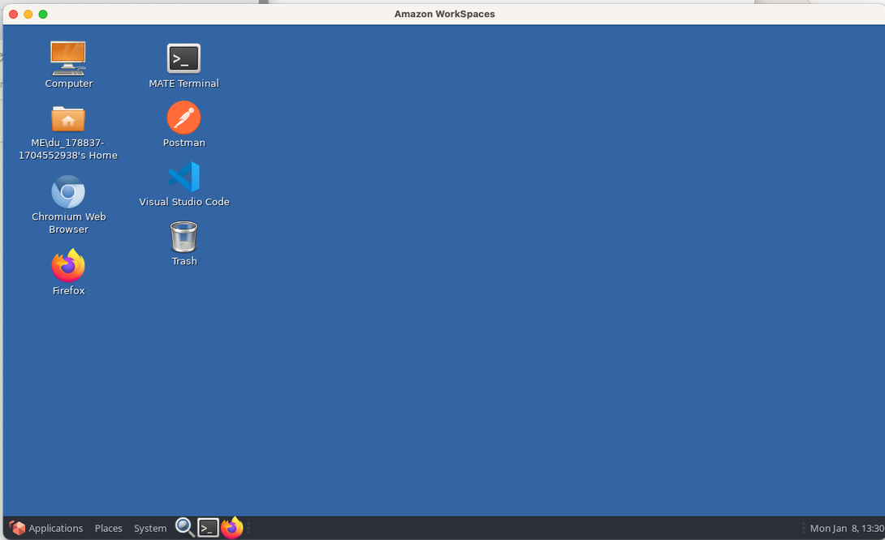

<h1>
  <span class="headline">Modern Engineering Installfest 2025</span>
  <span class="subhead">Connecting WorkSpaces to Git via SSH</span>
</h1>

## Setting up Git, SSH, and your Workspace

This guide will lead you through the essential steps to set up Git, generate an SSH key for GitHub authentication, and ensure your virtual workspace is ready for use. By the end, you'll have a fully configured environment to clone, push, and pull repositories without repeatedly entering your GitHub credentials.

## What you need to begin

**Before starting, ensure you have the following ready:**

1. **A Device Running AWS WorkSpaces**

   - Make sure your AWS WorkSpaces instance is set up and accessible.

2. **Stable Internet Connection**

   - A reliable internet connection is essential to complete the setup smoothly.

3. **Access to Your General Assembly GitHub Enterprise Account**

   - Verify that you can log in to the General Assembly GitHub organization.
   - If you are not yet a member of the General Assembly GitHub Enterprise Account, [create an account here](http://git-invite.generalassemb.ly/).

4. **Basic Understanding of Terminal Commands**
   - You should be comfortable running basic commands in a terminal (e.g., navigating directories, running scripts).

> **Need help?**  
> If you experience any issues, contact your instructor or the Installfest support team for assistance.

## Open your AWS Workspace

> **Important:** The following steps must be completed on your **AWS Workspace environment**, not on your local computer.

### Instructions:

1. **Locate the Terminal Application**  
   On your AWS Workspace desktop, look for the terminal application. This is the tool you'll use to run commands.

2. **Open the Terminal**  
   Launch the terminal application to begin completing the steps outlined in this guide.

   

## Step 1: Set up Git configuration

1. Configure your Git name and email globally:

   ```bash
   git config --global user.name "<YOUR_FULL_NAME>"
   git config --global user.email "<YOUR_EMAIL@example.com>"
   ```

2. Verify the configuration:
   ```bash
   git config -l
   ```

## Step 2: Generate and configure an SSH key

To make it easier, we’ll use a script to set up your SSH key and configure it for GitHub.

1. **Create the Setup Script**

   Follow these steps to create a file for the setup script:

   - Open your terminal in the AWS Workspace.
   - Navigate to your desktop directory:

     ```bash
     cd ~/Desktop
     ```

   - Create a new file named `setup_ssh.sh`:

     ```bash
     touch setup_ssh.sh
     ```

   This will create an empty file called `setup_ssh.sh` on your desktop, ready for you to add the script content.

2. **Copy and Paste the Script Below into the File**

   Open the file in a text editor (VSCode), then paste the following:

   ```bash
   #!/bin/bash

   # Prompt the user for their email address

   read -p "Enter your email address for the SSH key: " email

   # Generate a new SSH key using the provided email as a label

   ssh-keygen -t ed25519 -C "$email"

   # Navigate to the .ssh directory

   cd ~/.ssh || { echo "Failed to navigate to ~/.ssh directory"; exit 1; }

   # Create a config file if it doesn't exist

   touch config

   # And add the necessary configuration to the config file

   echo "Updating the SSH config file..."
   cat <<EOL > config
   Host *
     AddKeysToAgent yes
     IdentityFile ~/.ssh/id_ed25519
   EOL

   # Add the SSH key to the SSH agent
   ssh-add ~/.ssh/id_ed25519

   # Copy the public key to the clipboard based on the operating system
   if [[ "$OSTYPE" == "darwin"* ]]; then
     # macOS
     cat ~/.ssh/id_ed25519.pub | pbcopy
     echo "Public key copied to clipboard (macOS)."
   elif [[ "$OSTYPE" == "linux-gnu"* ]]; then
     # Linux
     if ! command -v xclip &> /dev/null; then
       echo "xclip is not installed. Installing xclip..."
       if command -v yum &> /dev/null; then
         sudo yum install -y xclip
       elif command -v apt-get &> /dev/null; then
         sudo apt-get update
         sudo apt-get install -y xclip
       else
         echo "Unsupported package manager. Please install xclip manually."
         exit 1
       fi
     fi
     cat ~/.ssh/id_ed25519.pub | xclip -selection clipboard
     echo "Public key copied to clipboard (Linux)."
   else
     echo "Unsupported OS. Please copy the public key manually."
     exit 1
   fi
   ```

3. **Run the Script**

   Make the script executable and run it:

   ```bash
   chmod +x setup_ssh.sh
   ./setup_ssh.sh
   ```

   - Enter your email address when prompted.
   - Press **Enter** for all prompts to use default settings (no passphrase, default file location).

4. **Add the SSH Key to GitHub**
   - Open [GitHub Settings > SSH and GPG Keys](https://github.com/settings/keys).
   - Click **New SSH Key**.
   - Paste the key copied by the script and give it a title (ex: "AWS Workspace").
   - Save the key.

## Step 4: Test your connection

1. Test your connection to GitHub in the terminal:

   ```bash
   ssh -T git@git.generalassemb.ly
   ```

## Setting up a global `.gitignore` ( Optional )

There are a few files that we don't want Git to track. To avoid tracking certain files (like `node_modules` or temporary files), we can configure a global `.gitignore`.

```bash
echo "/public/uploads/\nnode_modules/\nbower_components/" >> ~/.gitignore_global
git config --global core.excludesfile ~/.gitignore_global
```

## Update Node Version Manager ( Optional )

We will use [NVM](https://github.com/nvm-sh/nvm) to manage Node.js versions.

AWS WorkSpaces come pre-installed with NVM.

1. To verify that NVM is installed, run the following command::

   ```bash
   which nvm
   ```

2. This version of AWS WorkSpaces comes with Node.js v14.17.0. To install a different version of Node.js, run the following command::

   ```bash
   nvm install 16
   nvm alias default 16
   ```

With these steps complete, your workspace is ready to go!
