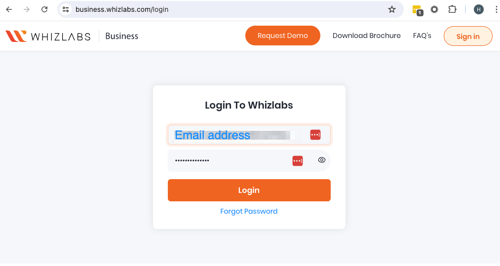
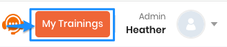
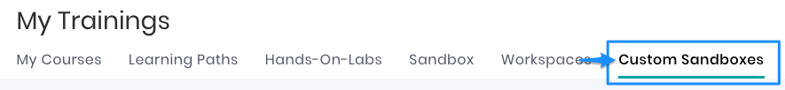
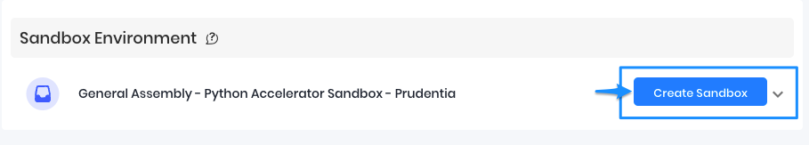
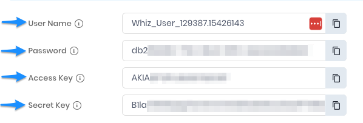
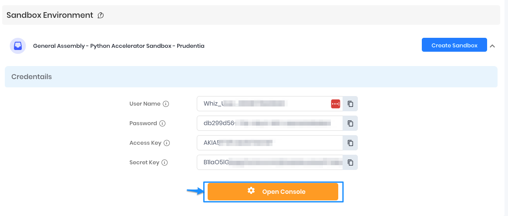
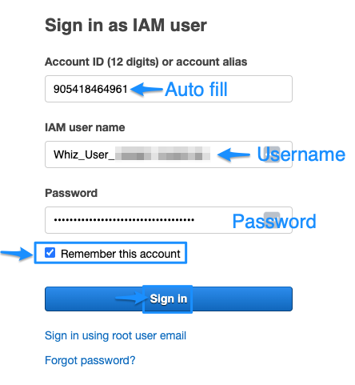
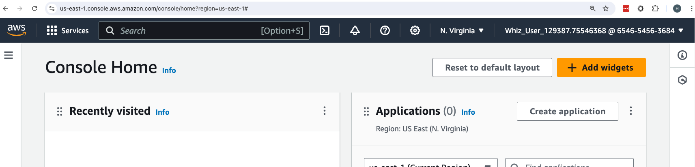

<h1>
  Modern Engineering Installfest 2025
  WhizLabs AWS Sandbox
</h1>

## WhizLabs AWS Sandbox

The following documentation refers to AWS sandboxes hosted by WhizLabs that grant both students and instructors access to the AWS console where they can access the AWS Services Set.

First, start by logging into the WhizLabs business portal: [Upskill your Entire Workforce with Whizlabs Teams Account!](https://business.whizlabs.com)

If an account hasn’t been established, please reach out to your appointed Client Success representative.

---

Once logged into the WhizLabs Business Portal, click on **My Training** in the upper right-hand corner next to your account name:

---

Click on **Custom Sandboxes** within the available tabs in the My Trainings module:

---

Within the **Custom Sandboxes** tab, you will see what sandboxes are assigned to you. These are the environments available to sign into.  
In the example below, the Python Accelerator sandbox has been provisioned. Click **Create Sandbox** to launch the sandbox environment under **Sandbox Environment**:

---

Once the sandbox is provisioned, in the same view, extend the arrow down to display your login criteria.  
The information provided is as follows:

- **User Name**
- **Password**
- **Access Key**
- **Secret Key**

The **Secret Key** is required when interacting with the Amazon CLI (Command Line Interface).

---

Click **Open Console** to log into the AWS environment:

---

Upon clicking **Open Console**, you will be taken to a sign-in page where you will need to input the above login criteria into the appropriate fields.  
After inputting the information, click **Sign In** to sign into the AWS console.

- The **Account ID** will be automatically filled into the Account ID placeholder.
- Feel free to select **Remember this account** for easier future sign-ons.

---

Upon successful sign-in, you will be signed into the AWS Console where you can begin utilizing the AWS services associated with your assigned curricula:

