<h1>
  Modern Engineering Installfest 2025
  WhizLabs Virtual Workspaces
</h1>

## Invitation from WhizLabs

Both students and instructors will receive an invitation to the WhizLabs platform as a result of being added as a user into the WhizLabs platform:

- **Subject Line:** Welcome to Whizlabs Business
- **Sender:** Whizlabs Business <support@whizlabs.com>

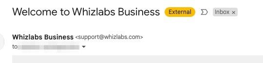

### The email contains the following:

- The URL they can use to access the WhizLabs Business site.
- The Username provisioned to the student (email address).
- A link to set up an account password.

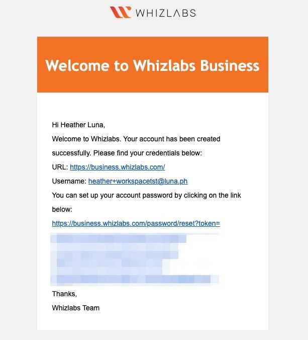

---

### Setting a WhizLabs Account Password and Logging into the WhizLabs Business Portal

In the **Reset Password** window, users should:

1. Choose a password of their choice.
2. Confirm the password.
3. Select **Submit** to save their new password.

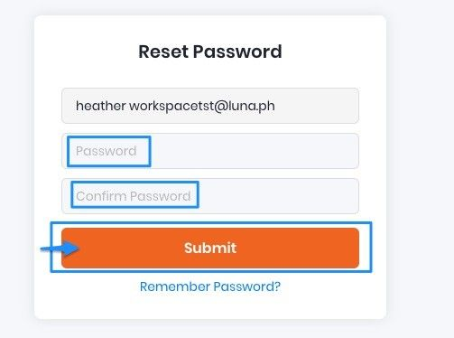

Users should then sign into the WhizLabs platform with the password they set up:  
[https://business.whizlabs.com](https://business.whizlabs.com)

Upon logging into WhizLabs' Business Portal, this is what users will see:

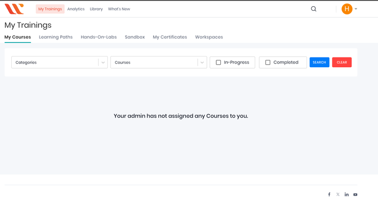

---

### Viewing Workspace Information

Once a user has been provisioned a WorkSpace, they can view their WorkSpace status, credentials, and registration code by visiting the **Workspaces** tab on their dashboard:

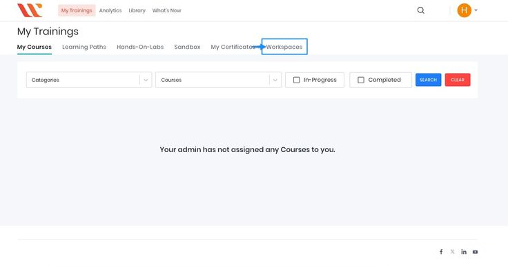

From the **Workspaces** tab, users can view:

- **End Date**: The date their instance stops.
- **Username**: Username for logging into the GA Amazon WorkSpace.
- **User Password**: Password for logging into the GA Amazon WorkSpace.
- **Workspace ID**: ID of the WorkSpace. If there are technical issues, refer to this ID.
- **Registration Code**: Used when signing into the Amazon WorkSpaces local client.
- **Download URL**: A reminder for where the Amazon WorkSpaces local clients can be downloaded.
- **Workspace Status**:
  - **STOPPED**: WorkSpace is in a stopped state. Allow 1-2 minutes for the WorkSpace to start up.
  - **AVAILABLE**: WorkSpace is available and ready to use.

### Ignoring the Amazon WorkDoc Email

Due to how WhizLabs is provisioning WorkSpaces, a one-time Amazon WorkDoc email will be sent. Users should ignore this email:

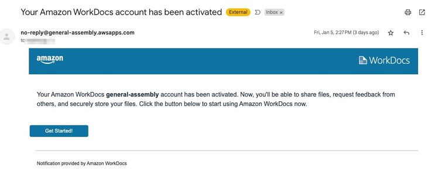

---

### Downloading and Launching the Amazon WorkSpaces Local Client

Users should download and install the local Amazon WorkSpaces client for their device from this URL:  
[Amazon WorkSpaces Client Download](https://clients.amazonworkspaces.com/)

> **_Note: Web access is not available at this time for use with GA Amazon WorkSpaces via WhizLabs._**

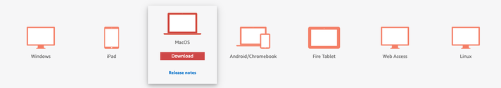

After installation, open the WorkSpaces client application:

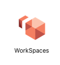

Upon launching the WorkSpaces client application, the user will be prompted to enter their **Registration Code**, which can be retrieved from their WhizLabs Business Portal.

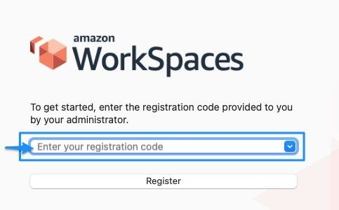

After entering the registration code, click **Register**:

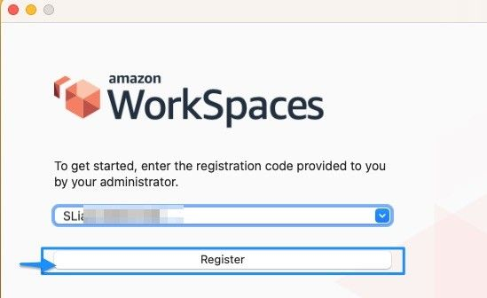

---

### Logging into the WorkSpace

After registering successfully, users will be prompted to enter their **Username** and **Password** to sign in.  
This information can be found on the **Workspaces** tab in the WhizLabs Business Portal:

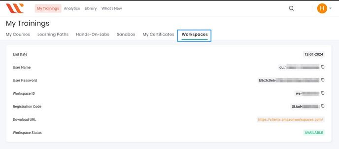

If the WorkSpace status is **STOPPED**, users will need to wait 1-2 minutes while it starts up.

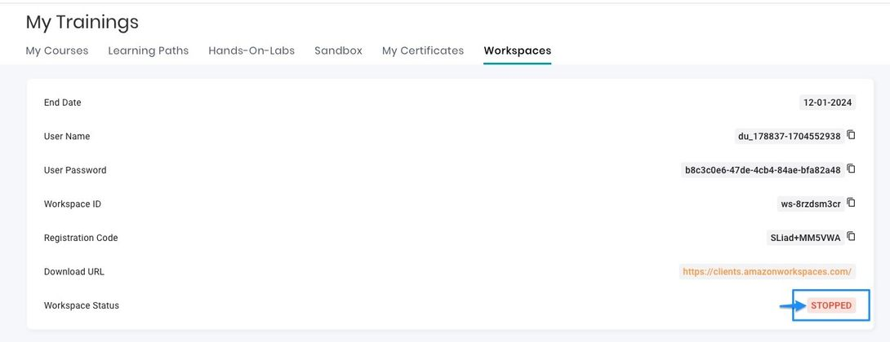

During this time, the following message will appear: **Starting WorkSpace**. Users should not exit the local WorkSpaces client during this process.

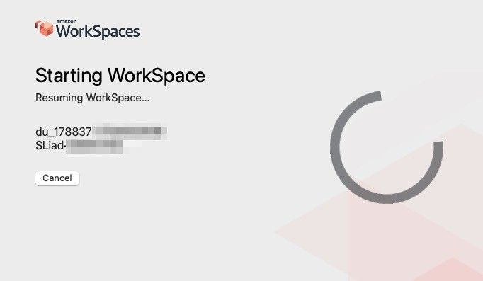

Once the WorkSpace starts, users will be deposited into the configured GA WorkSpace, which they can then use to support their learning.

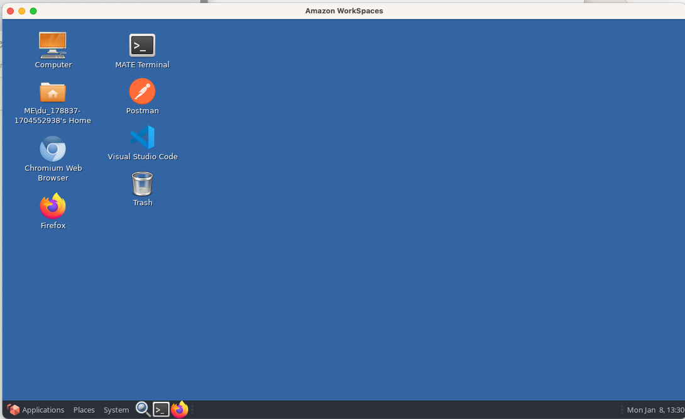
